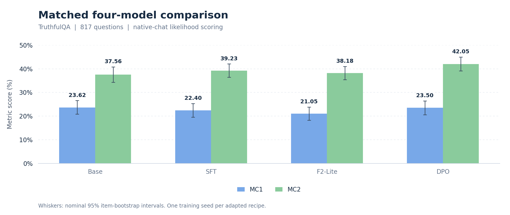

# Truthfulness LoRA

**Evaluating supervised fine-tuning and preference optimization on Qwen3-1.7B**

An exploratory undergraduate AI research study comparing four model recipes on **817 TruthfulQA questions** under one matched evaluation protocol.

[Results](#results) · [Methodology](#methodology) · [Reproduce](#reproduce) · [Research report](docs/RESEARCH_REPORT.md)

## Results



*Figure 1. Saved means on the same 817 questions; whiskers show nominal 95% item-bootstrap intervals. MC1 measures credit for ranking the designated best true answer above false alternatives. MC2 measures normalized likelihood mass on true choices. Neither measures factual accuracy of freely generated answers; intervals omit training-seed uncertainty.*

> **Main finding:** DPO achieved the highest MC2 (**42.050%**). Base retained the highest MC1 point estimate (**23.623%**); DPO was one correct question behind.

| Approach | What we did | MC1 (%) ↑ | MC2 (%) ↑ |
|:--|:--|--:|--:|
| Base | Released Qwen3-1.7B checkpoint without additional project training. | **23.623** | 37.561 |
| SFT | Standard LoRA fine-tuning using correct HaluEval answers. | 22.399 | 39.233 |
| F2-Lite | Three-task LoRA combining direct QA, background retrieval and knowledge-grounded QA. | 21.053 | 38.176 |
| DPO | SFT-initialized preference optimization using cleaned UltraFeedback preferences. | 23.501 | **42.050** |

## Understanding the Four Approaches

### Base — Released Qwen3-1.7B

We evaluated the released Qwen3-1.7B checkpoint without additional training for this project. It established the baseline for measuring how each later adaptation changed the model's answer rankings. All four recipes used the same frozen 817-question benchmark and native-chat likelihood protocol.

### SFT — Supervised Fine-Tuning

Supervised fine-tuning teaches a model to predict provided target answers. We used LoRA to train small adapter weights on 9,500 HaluEval question-and-correct-answer examples while keeping the underlying pretrained weights frozen. We tested whether that supervision transferred to better answer selection on TruthfulQA.

### F2-Lite — Multi-Objective Fine-Tuning

F2-Lite extends the supervised setup with direct QA, background prediction and knowledge-grounded QA. Each source item produced three correlated records, yielding 28,500 training records from the same 9,500 examples; background prediction was supervised generation of supplied text. We tested whether this combined supervision changed answer selection, without reproducing the full Faithful Finetuning algorithm.

### DPO — Direct Preference Optimization

DPO learns from pairs of preferred and rejected responses. Starting from the SFT adapter, we used cleaned UltraFeedback preferences and a separate frozen SFT reference to favor the preferred responses. We tested the additional stage's effect on TruthfulQA; these general-quality preferences are not independent factuality labels.

## Key findings

- **Higher MC2, limited MC1 change.** DPO exceeded SFT by **+2.817 percentage points** in MC2 (nominal paired 95% CI: +1.783 to +3.891). Its MC1 change was +1.102 points (−0.490 to +2.693).
- **Base retained the highest MC1 point estimate.** DPO ranked one fewer question correctly: 192 versus 193 out of 817. This is not evidence of equivalence.
- **A recipe comparison, not a causal claim.** DPO adds a different dataset and training stage. These results do not establish DPO-specific factual learning or broad hallucination reduction.

[Exact scores and paired comparisons](docs/RESULTS.md) · [Aggregate CSV](results/scores.csv) · [Figure source and vector version](results/figures/truthfulqa_comparison.svg)

## Research objective

How do supervised LoRA, an F2-inspired multi-objective recipe, and SFT-initialized DPO transfer to a truthfulness benchmark when every checkpoint uses the same evaluation protocol?

## Methodology

All arms start from the released [`Qwen/Qwen3-1.7B`](https://huggingface.co/Qwen/Qwen3-1.7B) checkpoint. “Base” here means the unmodified released checkpoint, not the separately named `Qwen3-1.7B-Base` model.

| Setting | Recorded protocol |
|:--|:--|
| Source splits | SFT and F2-Lite share a **9,500 / 500** HaluEval source-item split; DPO uses a separate **9,500 / 500** UltraFeedback preference split. |
| Adapters | SFT and F2-Lite use rank-16 LoRA adapters. DPO continues the SFT adapter with a separate frozen SFT reference. |
| Checkpoint selection | Validation loss selects checkpoints; TruthfulQA scores do not select the DPO checkpoint. |
| Evaluation | Same frozen questions, native-chat question wrapper and summed EOS-inclusive candidate log likelihoods for all four arms. |

The earlier six-demonstration harness results use a different protocol and remain in the [historical record](docs/history/README.md).

[Full methods and settings](docs/APPROACHES.md) · [Data audit](docs/DATA_AUDIT.md) · [Input identities](configs/input_identities.json)

## Reproduce

**Inspect the code and saved aggregates with Python 3.12:**

```bash
python3.12 -m venv .venv
source .venv/bin/activate
python -m pip install -e .
python -m truthfulness_lora --help
python -m unittest discover -s tests -p test_public.py -v
shasum -a 256 -c SHA256SUMS
```

**Regenerate the figure from the included aggregate results:**

```bash
python -m pip install -e '.[figures]'
python analysis/plot_results.py
```

These steps do not fetch datasets or model weights. Installation may download Python dependencies. Full training and inference require separately obtained inputs and compatible CUDA resources; see [reproduction instructions](docs/REPRODUCTION.md). Portable code has local CPU and packaging checks, but full GPU replay and the complete historical environment have not been reproduced.

## Repository guide

```text
src/truthfulness_lora/   Training, preprocessing and matched evaluation
configs/                Recorded settings and input hashes
results/                Aggregate scores, diagnostics and figures
notebooks/              Historical research notebooks with cleared outputs
analysis/               Figure generation and historical score verification
scripts/slurm/          Preserved historical HPC launchers
docs/                   Methods, report, reproduction and limitations
  history/              Earlier results, reports and experiment plans
tests/                  Synthetic CPU verification
release/                Source provenance and review records
```

[Public-facing structure and archive boundary](docs/REPOSITORY_GUIDE.md) · [Technical integration review](release/INTEGRATION_REVIEW.md)

## Limitations

- **One training seed and confounded recipes.** Data, objectives, learning rates, sequence lengths, precision and compute differ. Bootstrap intervals are nominal item-level intervals, without training-seed or multiplicity adjustment.
- **Failed preference-quality and shortcut gates remain failed.** Only 28/48 audited preferences were supported (80% required); 8/48 chosen responses were unusable (10% maximum). Answer-only estimates of 66.01% and 74.69% exceeded the 65% gate. No independent human audit forms were completed.
- **Bounded evidence.** Lexical overlap checks do not establish semantic or pretraining decontamination; four HaluEval supporting passages cross the split. Gains include regressions and post-hoc effects. No generated-answer factual evaluation was performed.

[Complete limitations](docs/LIMITATIONS.md) · [Exploratory analyses](docs/RESEARCH_REPORT.md)

## References

- Qwen team — [Qwen3 Technical Report](https://arxiv.org/abs/2505.09388).
- Li et al. — [HaluEval](https://arxiv.org/abs/2305.11747).
- Lin, Hilton and Evans — [TruthfulQA](https://arxiv.org/abs/2109.07958).
- Hu et al. — [LoRA](https://arxiv.org/abs/2106.09685).
- Hu et al. — [Mitigating Large Language Model Hallucination with Faithful Finetuning](https://arxiv.org/abs/2406.11267).
- Rafailov et al. — [Direct Preference Optimization](https://arxiv.org/abs/2305.18290).
- Cui et al. — [UltraFeedback](https://arxiv.org/abs/2310.01377).

## Attribution and citation

**Researcher:** Gechleng (Leng) Lim, undergraduate AI Research Assistant  
**Faculty advisor:** Professor Salem Othman  
**Institution:** Wentworth Institute of Technology  
**Compute:** UMass Unity HPC, NVIDIA GPU allocations through Slurm

This project was undertaken as an educational fine-tuning study. Citation metadata is provided in [CITATION.cff](CITATION.cff); upstream resources retain their own attribution and terms. See [source notices and project licensing status](docs/RIGHTS_AND_NOTICES.md) for the distribution scope.
